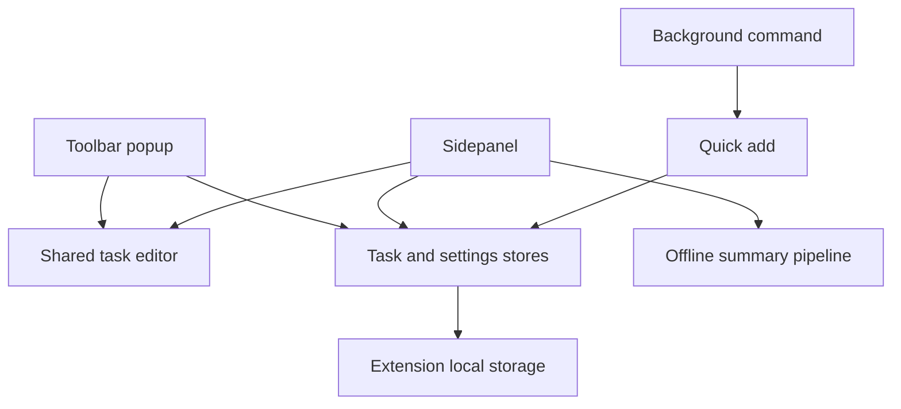

# Architecture

The app is a Chromium browser extension built with WXT, Svelte 5 and TypeScript. It uses native HTML controls styled with WebTUI, Day.js for dates, and bundled JetBrains Mono fonts. The app does not fetch models, fonts or summaries at runtime.

## Entrypoints and ownership

| Location under `src/`                   | Responsibility                                                                                |
| --------------------------------------- | --------------------------------------------------------------------------------------------- |
| `entrypoints/background.ts`             | Receives the extension command and opens quick add.                                           |
| `entrypoints/popup/`                    | Today's compact task list, settings, help and task editing.                                   |
| `entrypoints/sidepanel/`                | Time filters, list/summary views, task selection, import/export and clearing displayed tasks. |
| `entrypoints/new-task-form-popup/`      | Separate quick-add window with automatic timing.                                              |
| `lib/components/terminal/`              | Shared screen frame and native form wrapper.                                                  |
| `lib/components/tasks/TaskForm.svelte`  | Task editor shared by popup and sidepanel.                                                    |
| `lib/components/TrackedTaskCard.svelte` | Timeline task display and per-task actions.                                                   |
| `lib/components/SummaryView.svelte`     | One summary group, its duration and copy controls.                                            |
| `lib/stores/`                           | Task and settings persistence, timing and import rules.                                       |
| `lib/utils/summarize/`                  | Deterministic grouping and removal of near-duplicate fragments.                               |
| `lib/utils/`                            | Clipboard feedback, keyboard policy, duration formatting and opening quick add.               |
| `types/global.d.ts`                     | Existing task, settings and summary interfaces.                                               |

Entrypoints coordinate screen state and call stores. Shared components communicate through typed callback props. Shared components belong in `lib/`, so one entrypoint does not import another entrypoint's UI.

## Persistence and timing

`SettingsStore` and `TaskStore` wrap WXT storage. WXT names the keys `local:settings` and `local:tasks`, corresponding to the browser's local storage area. UI changes do not require a data migration.

A tracked task has a generated ID, title, description, optional status, creation time and nullable start/end times. Times are stored as ISO strings; native date/time controls display local values. Duration display ignores missing, invalid or reversed ranges and counts whole elapsed minutes, including ranges crossing midnight.

Adding a task without explicit times uses the latest task end on that day, falling back to the configured work start, and ends at the current time. Adding a task with a start and no end uses a 30-minute range. Updating a task can adjust neighboring tasks through the store's existing timing rules. Keep these rules in the store rather than reimplementing them in forms.

Popup and sidepanel subscribe to task storage changes and unsubscribe on unmount. Sidepanel loads use a version counter so older results cannot replace newer filter results. Invalid filters and failed loads clear displayed results; action guards prevent shortcuts from exporting, copying or editing stale results during loading.

Filtering currently uses task start for daily/custom ranges and creation time for weekly/monthly ranges. All time ignores the date field. This existing distinction is relevant when adding or editing tasks for a past date; changing it requires an explicit behavior decision and store tests.

The store persists the task array as a whole. It does not provide transactions across extension contexts; simultaneous writes from separate windows can overwrite one another. A future concurrency change belongs at this persistence boundary.

## Summaries

The pipeline normalizes titles, groups tasks with the same normalized title, parses task descriptions into fragments, removes near-duplicate fragments within each group, and formats summary groups. Similarity uses the overlap coefficient of character trigrams, with a default threshold of 0.9. The longest fragment in each connected set of near-duplicates is retained.

Every displayed fragment comes from the user's wording. No text generation or network access is involved. See [ADR 0001](adr/0001-deterministic-task-summary.md) before changing the algorithm.

Summary duration totals are calculated from the original tracked tasks, independently of fragment de-duplication. A task without fragments still contributes to the overall tracked duration, even if it produces no summary group.

## Import, export and clearing

Export downloads the tasks in the selected filter as JSON. Import delegates validation and ID de-duplication to `TaskStore.importTasks`, then refreshes the current view. Clearing removes the IDs currently displayed, preserving tasks outside the chosen period. Do not use the store's current-period reset methods to clear a historical view.
